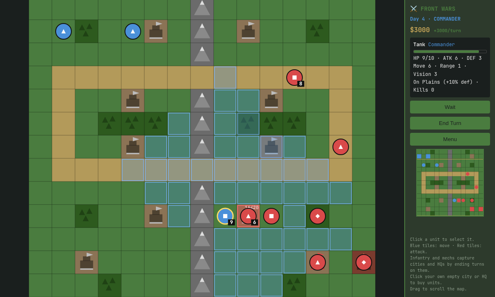

# Front Wars

A turn-based tactics game that runs in the browser. You command an army on a grid map, capture
cities for income, buy reinforcements and try to take the enemy headquarters, either against a
computer opponent or against a friend on the same device.

Plain HTML, CSS and JavaScript (Canvas API), with no frameworks and no build step.



## Features

- **Three game modes**: a 5-mission campaign with briefings, a skirmish against the AI, and local 2-player (hot seat)
- **Six unit types** with different movement, range, armor and vision: infantry, mech, recon, tank, artillery and anti-air
- **Terrain matters**: movement costs per unit type and defense bonuses for forests, mountains, cities and HQs
- **Economy**: infantry capture cities over two turns, cities pay income, and you deploy new units from your own properties
- **Combat** with counter-attacks, ranged artillery that can't move and fire in the same turn, and promotions after 3 kills
- **Fog of war**: you only see what your units and properties can see
- **AI opponent** that scores possible attacks, captures properties, positions its artillery and buys units
- **Autosave**, so you can continue a game later; campaign progress is remembered
- Works with mouse, touch and on small screens

## Play

Clone the repository and open `index.html` in a browser, or serve the folder:

```bash
git clone https://github.com/MinZziGOGOGO/frontwars.git
cd frontwars
npm start        # or: python -m http.server
```

### How to play

| Action | How |
|--------|-----|
| Select a unit | Click it. Blue tiles show where it can move, red tiles what it can attack |
| Move / attack | Click a blue or red tile |
| Wait | Click the selected unit again, press **W**, or use the *Wait* button |
| Capture | End your turn with infantry or a mech on a city or HQ (20 capture points; a full-HP unit adds 10 per turn) |
| Buy units | Click one of your own empty cities or your HQ |
| End turn | *End Turn* button or **E** |
| Scroll the map | Drag, or use the mouse wheel |

You win by capturing the enemy HQ or by destroying all enemy units.

## Tests

The game rules are separated from rendering and covered by tests that run in Node (no browser needed):

```bash
npm test
```

The 20 tests cover movement and terrain, combat and counter-attacks, capturing, income, buying,
fog of war, save/load, the validity of every campaign map, and complete AI-vs-AI games
for every mission.

## Project structure

```
frontwars/
├── index.html          # Layout, styles and overlays (menu, briefings, game over)
├── engine.js           # Game rules: map, units, combat, capturing, AI, save/load
├── main.js             # Rendering, input handling and game flow
└── tests/
    └── engine.test.js  # Engine tests (node --test)
```

## Tech stack

JavaScript (ES2022) · HTML5 Canvas · CSS · Node's built-in test runner
